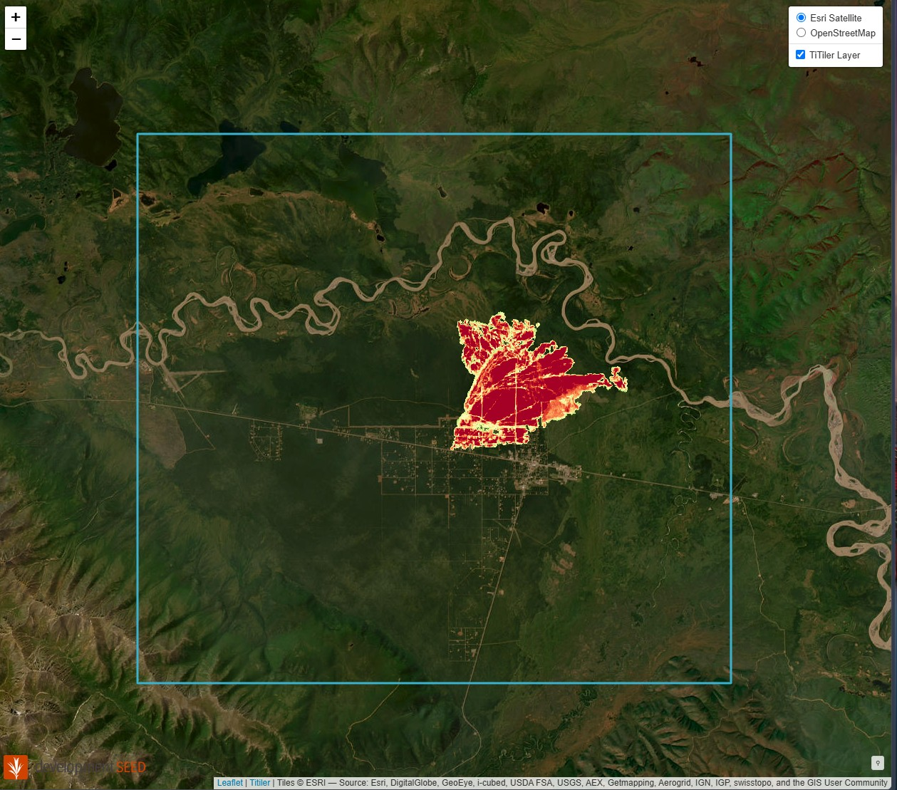

# Mukluk Fire (Tok, Alaska, 2026): burn-severity pipeline on cloud-native geospatial formats

Small end-to-end version of a satellite wildfire data pipeline: ingest, derive, catalog, query, serve.

| Stage | Tool | Output |
|---|---|---|
| Discover imagery | Earth Search STAC API (Sentinel-2 L2A) | pre-fire 11 Jul, post-fire 24 Sep 2026 |
| Derive | rasterio, NumPy: dNBR = NBR(pre) - NBR(post), SCL cloud mask | continuous + classified rasters |
| Validate | NASA FIRMS VIIRS hotspots (connected-component filter) | scar 6,937 ac vs. official 7,335 ac (95%) |
| Store | rio-cogeo, GeoPandas/pyarrow | Cloud Optimized GeoTIFFs, GeoParquet |
| Catalog | pystac | static STAC catalog on S3 |
| Query | DuckDB over GeoParquet | detections and FRP by area and time |

Run: `pip install -r requirements.txt && python pipeline.py && python query_hotspots.py` (`fetch_firms.py` refreshes the hotspot CSV and needs a free FIRMS key in `FIRMS_MAP_KEY`; a copy of the 2026 data is included).

Limitations: the burn scar is a threshold (dNBR >= 0.27) on one image pair, not a trained model; unburned wetland and water can produce false positives, which is why only components touching VIIRS hotspots are kept. VIIRS (375 m) hotspots are detections, not perimeters.

## Results

Severity legend: yellow = moderate-low (dNBR 0.27-0.44), orange = moderate-high (0.44-0.66), dark red = high (>0.66).
Burn severity by class: moderate-low 539 ac, moderate-high 1,366 ac, high 5,776 ac. VIIRS fire radiative power fell from ~5,900 MW (18 Aug) to ~900 MW (20 Aug).

## Cloud setup
S3 bucket (lifecycle to Glacier after 30 days), least-privilege IAM role, EC2 running TiTiler in Docker (security group limited to one IP; terminated after the demo), CloudWatch log group + metric filter + alarm + SNS email, ArcGIS Online hosted layers and Dashboard.

Live dashboard: https://www.arcgis.com/apps/dashboards/bf530ea51aa449448ab264c5bea3d631

## Outputs in `out/`
Burn severity and dNBR COGs, VIIRS hotspots (GeoParquet and GeoJSON), daily fire extent, and a static STAC catalog (`out/stac/`) whose asset links point to the original S3 bucket.

## Data and licence
Contains modified Copernicus Sentinel-2 data (2026); NASA FIRMS VIIRS. Code: MIT.
